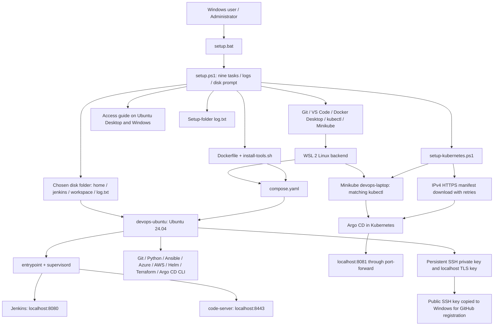

# DevOps laptop project: purpose, architecture and commit history

This project provisions a Windows laptop with Docker Desktop, Git, VS Code and a local Kubernetes cluster, plus a persistent Ubuntu DevOps toolbox running Jenkins and a VS Code compatible web editor. Argo CD runs inside Minikube. The setup provides visible task results, transcripts, persistent disk data, access instructions and GitHub SSH/local TLS keys.

Use [README.md](README.md) for installation and [ACCESS.md](ACCESS.md) for tool settings and URLs. Run `setup.bat` as administrator, choosing the same persistent folder on reruns.

## Repository and reconstruction

Repository: `C:\Ashish\repo\DevOPs_setup`. Branch: `codex/devops-setup`. This is an independent nested repository under the existing `C:\Ashish\repo` repository; the parent's history was not changed. Existing Git author identity is reused. No remote was added and no commits were pushed.

These commits were created on **6 October 2026 (Asia/Dubai)** from the conversation history. They are retrospective reconstructions, not commits that existed when the failures occurred. Intermediate commits intentionally show the earlier bugs; the final source files match the working copies before reconstruction. Only changes evidenced in this chat are represented. The requested copy to this folder and task-9 runtime execution are operations, not additional source changes.

## Architecture



Ubuntu Docker CLI has no host socket or daemon. Local cluster credentials stay on Windows. Service ports bind to loopback. Generated private keys/cloud credentials remain in the persistent home and are not committed. Self-signed TLS is generated separately from GitHub SSH authentication; service TLS configuration and GitHub public-key registration are follow-up steps in the guide.

## Commit-by-commit purpose

All hashes below identify actual commits in this repository. Use `git show <hash>` to inspect each change.

| No. | Commit hash | Commit | Files | Purpose |
| --- | --- | --- | --- | --- |
| 1 | `c95882c22b1c977895cf3be96cee3b1bc861974c` | feat: create .gitignore | `.gitignore` | Exclude generated data, transcripts, runtime state, reports and key material from source control. |
| 2 | `5762f1c636496ff0dc2467cc7aa4208b6243071c` | feat: create .dockerignore | `.dockerignore` | Exclude local repository data, logs and key material from Docker build context. |
| 3 | `5d4e7d435cd298b58ac06fe1cba596d4877976bb` | feat: create setup.bat | `setup.bat` | Launch Windows PowerShell from this folder and display its exit result. |
| 4 | `3b9e95d67de6b4c51ed8280243b856260cb765d1` | feat: create setup.ps1 | `setup.ps1` | Create the initial nine-task Windows installer with storage prompt, environment settings, logs and error handling. |
| 5 | `348dab7d4630e475725d08b23bfd45b5d20be3d8` | feat: create Dockerfile | `Dockerfile` | Define Ubuntu 24.04 image, CLI installation, DevOps user and supervised services. |
| 6 | `8cff6aa88b8dd1e79218ec64692e12a37c6a46a6` | feat: create install-tools.sh | `install-tools.sh` | Install DevOps packages and CLIs from their upstream repositories and release downloads. |
| 7 | `5b915ecfed3b46384b9d01da2f12888c6d9c194e` | feat: create compose.yaml | `compose.yaml` | Start Ubuntu services with persistent disk bind mounts, loopback ports and health checks. |
| 8 | `d53253e79c3016deb234d6c6aef5e3eee98bb3ad` | feat: create entrypoint.sh | `entrypoint.sh` | Prepare persistent folders and editor authentication, then launch the supervisor. |
| 9 | `1757cd8326da6bce564cecdc630acf881ca4a27d` | feat: create supervisord.conf | `supervisord.conf` | Supervise Jenkins and the VS Code compatible browser editor and expose service logs. |
| 10 | `545183d42d4a2cdc268fb1a896f5bc061024143b` | feat: create verify-tools.sh | `verify-tools.sh` | Verify installed tool versions and report failures. |
| 11 | `f3983493a21235e7219ccf39ba94735dc30b1ed1` | feat: create create-keys.sh | `create-keys.sh` | Create or preserve GitHub Ed25519 SSH and localhost TLS keys without exporting private keys. |
| 12 | `807fa32b3e0c99005aabafcb89f141d8cd101249` | feat: create ACCESS.md | `ACCESS.md` | Explain service URLs, credential retrieval, cloud settings and GitHub key registration. |
| 13 | `6a4743f44cef8c3f44a3c412f7c2aa0d3ba99e1d` | feat: create README.md | `README.md` | Document installation, requirements, purposes, expected output, daily use and troubleshooting. |
| 14 | `21237c236033da931931d36ce94c861b623f0194` | fix: polish native command logging and Compose invocation | `setup.ps1, README.md` | Handle native stderr in Run, preserve empty user PATH, use global Compose progress option, render the success newline and copy logs after closing the transcript. |
| 15 | `0f7201103e18980b06028159dfd97ded4d81b15c` | fix: retry missing Docker engine without PowerShell termination | `setup.ps1, README.md` | Capture expected native probe failures, launch installed Docker Desktop, report startup progress and handle absent Kubernetes namespaces safely. |
| 16 | `1fef33f7b24803333f4471fe70f6a091a6461225` | fix: parse Docker engine type alongside startup warnings | `setup.ps1` | Recognize Linux or Windows result lines independently of warnings and log unexpected responses rather than falsely requesting a mode switch. |
| 17 | `519a224af84fd5c5ffefd408bbdf389cde7aee18` | fix: report manually paused Docker Desktop | `setup.ps1` | Detect the daemon paused message and provide a resume instruction immediately. |
| 18 | `727c799a875f84add8697ca0d0d8a7e0d426e6a9` | fix: retry HTTP 500 until Docker reports a valid engine | `setup.ps1, README.md` | Require both exit success and recognized engine output, enable API negotiation within this process, and include diagnostic responses on timeout. |
| 19 | `0772912e880732ac1b6ceb669670549afa27a221` | feat: create setup-kubernetes.ps1 | `setup-kubernetes.ps1` | Wait for Ready nodes, use version-matched Minikube kubectl and retry the IPv4 manifest download before applying locally. |
| 20 | `35f50d7266a36505fe0e4e7dc81b6646a7175a5f` | fix: wait for Kubernetes and retry Argo CD downloads over IPv4 | `setup.ps1, README.md, .gitignore, .dockerignore` | Integrate the cluster helper, retain downloaded manifests locally, exclude generated manifests from Git/builds and document connection-reset recovery. |
| 21 | `e9806cec412c4d9b4d8f22b1a7f1ae8d2e91723d` | fix: check individual Argo CD deployments without unsupported all flag | `setup-kubernetes.ps1` | List deployment resource names, validate them and wait on each rollout before checking the application controller. |
| 22 | `171e262185784b0feabe799dd5dc08b7359880b0` | fix: specify Ubuntu container in access-guide chown command | `setup.ps1` | Pass devops-ubuntu before chown so Docker does not interpret chown as a container name; task 9 was then completed directly and logged. |

The final documentation commit creates this `read.md` and records the full source history above. Its purpose is to explain the project architecture, each file creation and every reconstructed fix. Its reference is `HEAD` at delivery, with subject `docs: document project architecture and reconstructed commit history`. Its own hash cannot be embedded in its committed content without changing that hash; retrieve it with `git log -1 --format=%H -- read.md`.

## Validation and observed results

- PowerShell syntax, Bash syntax and Docker Compose configuration checks passed during the conversation.
- Native failure probes and Docker engine readiness/parsing regression checks passed.
- Docker was observed running Linux with client/server API 1.51; transient errors and paused state were handled in later fixes.
- The Argo CD manifest download over IPv4 succeeded. The cluster was created; rollout checks were corrected after the unsupported flag was reported.
- The user's run reached task 9, and the corrected access-guide copy/ownership task completed directly. This does not constitute independent verification of cloud authentication, GitHub registration, every Jenkins plugin or application behavior.
- Final reconstructed file contents were restored and checked against the original destination snapshots.

## Local Git usage

```powershell
cd C:\Ashish\repo\DevOPs_setup
git status
git log --oneline --reverse
git show <commit-hash>
```

Logs, runtime state, generated access reports/public key, local data and downloaded manifests are ignored. Do not add the chosen persistent data folder, private keys or cloud credentials. This repository contains source and documentation, not backups of running services.
